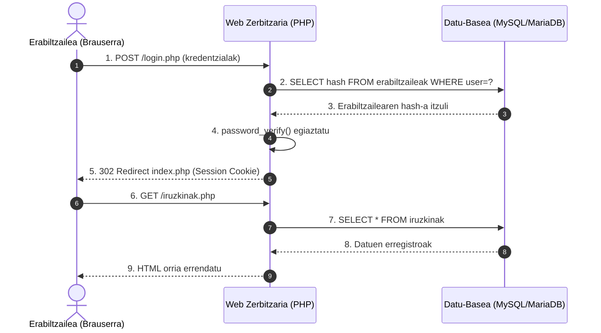

# WAE & IAW - Web Aplikazioak eta Garapena

**Moduluak:** Web Aplikazioen Ezarpena (WAE) & Web Inguruneko Aplikazioak (IAW)  
**Helburua:** CMS segurtasuna, GitHub bidezko kudeaketa eta talde-lana, intraneta garatzea (zerbitzariko script-ak, autentifikazio segurua, dependentzia murrizketa) eta datu-basearekin konektatutako iruzkinen sistema kudeatzea.  
**Erreferentzia-rubrika:** WAE IE2 (%1), WAE IE4 (%9), WAE IE5 (%15), IAW IE6 (%15) -> Pisu Osoa: %40.00

---

## 1. WordPress Segurtasun Kopiak eta Leheneratzea (WAE IE2)
*Rubrika Aurreratua (10):* Kopia bat egin da. Kopia nola egiten den eta nola berreskuratzen den azaldu da, **bi sistema ezberdin** erabiliz.

### 1.1. Sistema 1: Kudeaketa Bereziko Plugina (Adib. UpdraftPlus / All-in-One WP Migration)
* **Kopia egiteko prozedura:**
  1. Plugin-a instalatu eta aktibatu WordPress panelean.
  2. Datu-basea, pluginak, gaiak eta fitxategi kargatuak hautatu.
  3. Kopia sortu eta kanpoko biltegira edo lokalera jaitsi.
* **Leheneratzeko prozedura (Restore):**
  1. Larrialdi egoeran kopia hautatu eta "Restore" sakatu.
  2. Taulen eta fitxategien osotasuna egiaztatu.
* **Ebidentziak / Pantaila-argazkiak:**
> *(Gehitu hemen kopiaren eta leheneratzearen argazkiak)*

### 1.2. Sistema 2: Eskuzko Kopia edo CLI / Script bidez (WP-CLI + `mysqldump` + `tar`)
* **Kopia sortzeko komandoak:**
```bash
# Fitxategien segurtasun-kopia
tar -czvf /backup/wp_files_$(date +%F).tar.gz /var/www/html/wordpress

# Datu-basearen segurtasun-kopia
mysqldump -u wp_user -p'PasahitzaWP' wordpress_db > /backup/wp_db_$(date +%F).sql
```
* **Berreskuratzeko (Disaster Recovery) prozedura:**
```bash
# Fitxategiak deskonprimitu
tar -xzvf /backup/wp_files_XXXX.tar.gz -C /var/www/html/

# Datu-basea berrezarri
mysql -u wp_user -p'PasahitzaWP' wordpress_db < /backup/wp_db_XXXX.sql
```
* **Ebidentziak / Pantaila-argazkiak:**
> *(Gehitu hemen kontsolako komandoen eta fitxategien argazkiak)*

---

## 2. GitHub Bidezko Planifikazioa eta Talde-Garapena (WAE IE4)
*Rubrika Aurreratua (10):* GitHub Projects erabili da plangintzarako, eguneroko jarraipena egin da, taldeko kide guztiek parte hartu dute repositoriotik, garapenean branch ezberdinak sartu dira eta ebidentziak ageri dira.

### 2.1. GitHub Projects Eguneroko Jarraipena
* **Taularen esteka / Antolaketa (Kanban):** To Do, In Progress, Review, Done.
* **Eguneroko jarraipenaren ebidentziak:**
> *(Gehitu hemen proiektuaren taulako sprint, ataza eta eguneroko aurrerapenen pantaila-argazkiak)*

### 2.2. Git Lan-Fluxua: Branch-ak eta Taldeko Kolaborazioa
* **Erabilitako adarrak (Branches):** `main`, `develop`, `feature/intranet-login`, `feature/iruzkinak-panel`, etab.
* **Pull Request-ak eta kideen parte-hartzea:**
```bash
git checkout -b feature/intranet-auth
# Garapena egin...
git add .
git commit -m "feat(auth): pasahitzen hash egiaztapena gehitu"
git push origin feature/intranet-auth
```
* **Ebidentziak:**
> *(Gehitu hemen `git log --graph`, GitHub adarren zerrenda eta PRen onarpenak)*

---

## 3. Intranetaren Garapena eta Arkitektura (WAE IE5)

### 3.1. Intranetaren Diseinua eta Nabigazioa
*Rubrika Aurreratua (10):* Gutxieneko orriak (Login orria, ongi-etorria, GLPI atzipena, iruzkin-orria, menua), erabilera-gida dokumentatua eta diseinu korporatibo bateratua (CSS/HTML).

* **Orrien Egitura:**
  - `login.php`: Saioa hasteko pantaila korporatiboa.
  - `index.php` / `home.php`: Ongi etorria erabiltzailearen informazioarekin.
  - `glpi.php` / `estekak.php`: Enpresako GLPI ticket sistemarako lotura zuzena eta argibideak.
  - `iruzkinak.php`: Iruzkinen ikuspegi eta formulario orria.
  - `menu.php` / `header.php`: Nabigazio barra koherentea orri guztietan.
* **Diseinu Korporatiboa:** Kolore-paleta, tipografia eta estilo orri bateratua.
* **Ebidentziak / Pantaila-argazkiak:**
> *(Gehitu hemen intraneteko interfazearen irudiak)*

---

### 3.2. Sarbide Segurua eta Autentifikazioa
*Rubrika Aurreratua (10):* Pasahitz enkriptatuak erabiltzen dira (`password_hash` / `password_verify`), logeatzean hasiera orrira bideratzen da, eta logeatzeko **beste sistema alternatibo bat** aztertu eta probatu izanaren ebidentziak daude (adib. LDAP / Active Directory bidezko autentifikazioa).

* **PHP Autentifikazio Segurua (Bcrypt / Argon2):**
```php
// Erabiltzailea balioztatzeko adibidea
$pasahitza = $_POST['password'];
if (password_verify($pasahitza, $erabiltzaile['pasahitza_hash'])) {
    $_SESSION['erabiltzailea'] = $erabiltzaile['username'];
    $_SESSION['rola'] = $erabiltzaile['rola'];
    header("Location: index.php");
    exit();
}
```

* **Sistema Alternatiboaren Azterketa eta Froga (LDAP / Active Directory atzipena):**
```php
// LDAP bidezko autentifikazio proba
$ldap_host = "ldap://192.168.1.10";
$ldap_conn = ldap_connect($ldap_host);
ldap_set_option($ldap_conn, LDAP_OPT_PROTOCOL_VERSION, 3);
if ($ldap_conn) {
    $bind = @ldap_bind($ldap_conn, "$user@enpresa.eus", $password);
    if ($bind) {
        // Domeinuko erabiltzailea onartua
    }
}
```
* **Ebidentziak:**
> *(Gehitu hemen pasahitzen hash biltegiratzea eta LDAP/AD probaren logak)*

---

### 3.3. Kanpoko Dependentziak Murriztea eta Datu-Fluxuaren Diagrama
*Rubrika Aurreratua (10):* Kendutako kanpo liburutegiak (adib. kanpoko CDN-ak, framework handiak edo dependientziak), erabilitako teknika alternatiboak (Vanilla JS / Native PHP / CSS garbia), inplementazioa eta **datuen ibilbidearen diagrama (Mermaid)**.



* **Ebidentziak:**
> *(Gehitu hemen dependentziarik gabeko kodearen froga)*

---

## 4. Iruzkinen Atala eta Kudeaketa Panela (IAW IE6)

### 4.1. Iruzkinen Bistaratzea eta Gehitzea
*Rubrika Aurreratua (10):* Datu-baseko iruzkinak ageri dira, egilearen izena ikusten da, erabiltzaile guztiek iruzkin berriak sartzeko aukera dute eta funtzionamendua argi dokumentatuta dago.

* **Iruzkinak Txertatzea (Prepared Statements):**
```php
$stmt = $pdo->prepare("INSERT INTO iruzkinak (erabiltzaile_id, edukia, data) VALUES (?, ?, NOW())");
$stmt->execute([$_SESSION['user_id'], htmlspecialchars($_POST['edukia'])]);
```
* **Ebidentziak:**
> *(Gehitu hemen formularioaren eta iruzkinen bistaratzearen argazkiak)*

---

### 4.2. Iruzkinak Ezabatzeko Panela eta Hobekuntza Proposamena
*Rubrika Aurreratua (10):* Iruzkinak borratzeko panela sortu da. Edonork borratu ahal izatea aztertu da, eta **modu egokiago batean nola egin zitekeen** (segurtasun ikuspegitik) xehetasunez justifikatu da.

* **Egindako Kudeaketa Panela:**
  - Panelak iruzkin guztiak zerrendatzen ditu eta ezabatzeko botoi bat dauka.
* **Kritika eta Hobekuntza Proposamena (Segurtasun eta RBAC Analisia):**
  - *Arazoa:* Erabiltzaile guztiek edonoren iruzkinak ezabatu ahal izateak osotasuna eta auditoretza urratzen ditu (IDOR eta baimen falta).
  - *Irtenbide optimoa:* **Role-Based Access Control (RBAC)** ezartzea. Erabiltzaile arruntak soilik bere iruzkinak ezaba ditzake (`WHERE id = ? AND erabiltzaile_id = ?`); moderatzaile edo administratzaile rolek berriz iruzkin guztiak kudeatu ditzakete.
```php
// Bertsio seguruaren adibidea:
if ($_SESSION['rola'] === 'admin' || $iruzkin['erabiltzaile_id'] === $_SESSION['user_id']) {
    // Ezabatzeko baimena eman
}
```
* **Ebidentziak:**
> *(Gehitu hemen ezabatze-panelaren argazkiak)*
