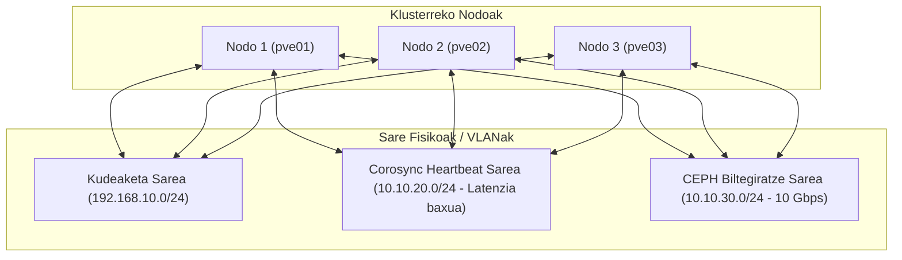

# SB - Sistema Birtualizatuak eta Goi-Eskuragarritasuna

**Modulua:** Sistema Birtualizatuak eta Goi-Eskuragarritasuna  
**Helburua:** Enpresako zerbitzuen negozio-jarraikortasuna eta zerbitzu-etenen aurkako babesa: hardware soluzio erredundanteak, Proxmox VE bidezko HA Klusterra, CEPH eta Corosync-erako sare bereiziak, biltegiratze banatua eta Makina Birtualen (VM) zein Edukiontzien (LXC) failover automatikoa.  
**Erreferentzia-rubrika:** IE2 (%5.0) eta IE4 (%36.0) -> Pisu Osoa: %41.00

---

## 1. Jarraikortasuna Bermatzeko Hardware Soluzioak (IE2)
*Rubrika Aurreratua (10):* Ezarri den sistema aukeratzeko arrazoi guztiak dokumentatuta, erabilitako hardware irtenbideak arrazoituta.

### 1.1. Jarraikortasun eta Eskuragarritasun Oinarriak
* **SLA (Service Level Agreement) helburuak:** %99.9ko erabilgarritasuna bermatzea.
* **Hutsegite-Puntu Bakarrak (SPOF - Single Point of Failure) ezabatzea:**
  - Elikadura elektrikoa.
  - Sareko komunikazioa (Switchak eta txartelak).
  - Biltegiratze fisikoa (Diskoak eta kontroladoreak).

### 1.2. Aukeratutako Hardware Soluzioak eta Justifikazioa
| Elementua | Hardware Aukeraketa | Erredundantzia Mekanismoa | Justifikazio Teknikoa |
| :--- | :--- | :--- | :--- |
| **Elikadura** | Dual Hot-Swap PSU + SAI/UPS bereiziak | Hornidura bikoitza linea independenteetatik | Nodo bat ez da itzaltzen iturri bat edo linea elektriko bat erortzean |
| **Sare Txartelak** | Sare-txartel bikoitzak (NIC Teaming / LACP Bonding) | 802.3ad agregazioa switch desberdinetara | Txartel edo kable bat apurtuz gero konexioak martxan jarraitzen du |
| **Diskoak** | SAS Hot-Swap Enterprise SSD-ak | RAID 1 / RAID 10 kontroladore bidez | Disko bat beroan ordezkatzeko aukera sistema gelditu gabe |

---

## 2. Goi-Eskuragarritasuneko Klusterra eta Sareak (IE4)
*Rubrika Aurreratua (10):* Nodo anitzeko HA Klusterra instalatuta, Corosync eta CEPH-erako sare fisiko/birtual isolatuak, biltegiratze partekatu banatua, eta VM nahiz LXC edukiontzien HA failover frogatua.

### 2.1. Sareen Isolamendua (Corosync & CEPH)
Corosync heartbeat trafikoa eta CEPH biltegiratze-erreplikazioa sare bereizietan kokatzen dira latenziak saihesteko eta klusterraren egonkortasuna bermatzeko (split-brain prebenituz).



* **Corosync Konfigurazioa (`/etc/pve/corosync.conf`):**
```text
totem {
  version: 2
  cluster_name: erronka2-cluster
  ip_version: ipv4
  interface {
    linknumber: 0
    knet_transport: unicast
  }
}
```

---

### 2.2. CEPH Biltegiratze Sistema Partekatua
* **CEPH OSD (Object Storage Daemon):** Nodo bakoitzean dedikatutako diskoak OSD gisa gehituta.
* **Pool-ak eta Erreplikazio Faktorea:** `size: 3`, `min_size: 2` (Datuen hiru kopia mantentzen dira nodoetan zehar).
* **Proxmox Storage Konfigurazioa:** `ceph-pool` erabilgarri klusterreko nodo guztietan VM diskoentzat.

---

### 2.3. Makina Birtualak (VM) eta Edukiontziak (LXC) Goi-Eskuragarritasunean (HA)
* **HA Baliabideen Definizioa:**
  - `VM 100 (Intranet Web Zerbitzaria)` -> HA kudeatzailean gehitua (`ha-manager set vm:100 --state started --group hagroup1`).
  - `CT 200 (DNS/DHCP Edukiontzia - LXC)` -> HA kudeatzailean gehitua (`ha-manager set ct:200 --state started --group hagroup1`).

---

### 2.4. Failover Egiaztapen-Froga Praktikoa
1. **Hasierako Egoera:** VM 100 eta CT 200 `pve01` nodoan aktibo daude.
2. **Hutsegite Simulatua:** `pve01` nodoko korrontea eskuz eteten da (`poweroff` edo sare-kableak deskonektatuz).
3. **Klusterraren Jokabidea:**
   - Corosync-ek `pve01` lineaz kanpo detektatzen du.
   - Quorum-a mantentzen da (`pve02` eta `pve03` bizirik daudelako).
   - CEPH-ek datuen osotasuna bermatzen du biltegiratze partekatutik.
   - HA kudeatzaileak VM 100 eta CT 200 automatikoki birabiarazten ditu `pve02` nodoan.
4. **Zerbitzuaren Berrezartze Denbora:** Zerbitzua minutu bat baino gutxiagoan berriro martxan dago.
* **Ebidentziak:**
> *(Gehitu hemen Proxmox HA kudeatzailearen egoera, logak eta failover uneko pantaila-argazkiak)*
