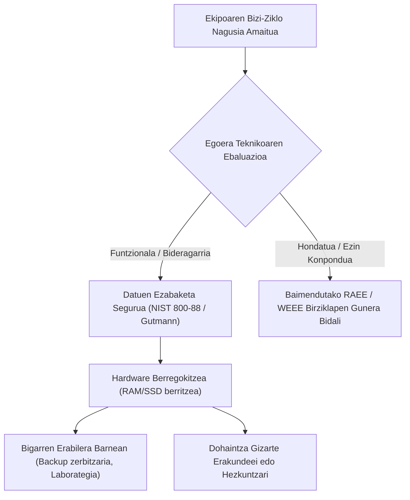

# JASAN - Jasangarritasuna eta Ekonomia Zirkularra

**Modulua:** Jasangarritasuna Aplikatua (Sostengarritasuna)  
**Helburua:** IT azpiegituretan jasangarritasun-plana definitzea: ESG dimentsioak (Ingurumena, Gizartea, Gobernantza), 2030 Agendako Garapen Jasangarrirako Helburuak (GJH / ODS), ekipo elektronikoen berrerabilera-prozesu arautua eta osagaien araberako kutsadura-aztarna zehatza.  
**Erreferentzia-rubrika:** IE1 (%10.0) eta IE4 (%20.0) -> Pisu Osoa: %30.00

---

## 1. Jasangarritasun Plana: ESG Dimentsioak eta GJH / ODSak (IE1)
*Rubrika Aurreratua (10):* ESG-ren hiru alderdiak erabili eta 2030 Agendako GJH helburuekin guztiz erlazionatu plana.

### 1.1. ESG Dimentsioak (Ingurumena, Gizartea eta Gobernantza)
* **Ingurumena (Environmental):**
  - Energia kontsumoaren optimizazioa (zerbitzarien birtualizazioaren bidez hardware fisikoa murriztea).
  - PUE (Power Usage Effectiveness) metriken kontrola CPD gelan.
  - Berriztagarrien bidez hornitutako energia aukeratzea.
* **Gizartea (Social):**
  - Langileen prestakuntza digitala eta telelan eraginkorra (VPN bidez mugikortasuna eta emisioak murriztuz).
  - Zabor elektronikoaren birziklapen kanpainak eta gizarte-erakundeekin lankidetza.
* **Gobernantza (Governance):**
  - Datuen pribatutasun etikoa eta gardentasuna (RGPD/DBLO betetzea).
  - Erosketa berdeen politika enpresaren hornitzaileekin (Green Procurement).

---

### 1.2. 2030 Agendako Garapen Jasangarrirako Helburuak (GJH / ODS)
| GJH / ODS | Deskribapena | Proiektuko Aplikazio Praktikoa |
| :---: | :--- | :--- |
| **GJH 7** | Energia Garbia eta Merkea | Energia-eraginkortasun handiko zerbitzariak (80 PLUS Platinum) eta itzalpen programatuak |
| **GJH 8** | Lan Duina eta Hazkunde Ekonomikoa | Telelan segurua, zeregin errepikakorren automatizazioa langileen bizi-kalitatea hobetzeko |
| **GJH 9** | Industria, Berrikuntza eta Azpiegitura | Azpiegitura erresilientea eta Goi-Eskuragarritasuna (HA Klusterra eta IoT sentsoreak) |
| **GJH 12** | Ekoizpen eta Kontsumo Arduratsuak | Hardwarearen bizi-zikloa luzatzea, konponketak eta ekonomia zirkularra sustatzea |
| **GJH 13** | Klimaren Aldeko Ekintza | Karbono-aztarnaren neurketa eta zerbitzarien karga optimizatuz CO2 emisioak murriztea |

---

## 2. Ekonomia Zirkularra eta Kutsadura Aztarna (IE4)

### 2.1. Ekipo Elektronikoen Berrerabilera Prozesua (Arautua)
*Rubrika Aurreratua (10):* Berrerabilera prozesu argia eta arautua jasangarritasun planaren barruan txertatua.

* **Datuen Ezabaketa Ziurtatua:** DBAN / Shred erabiliz diskoak garbitzea datu-ihesak saihesteko.
* **Bizitza Erabilgarriaren Luzapena:** Ekipoak 3 urtetik 6-7 urtera luzatzea bigarren mailako funtzioetan.

---

### 2.2. Ekipo Elektronikoen Kutsadura Aztarnaren Analisia Osagaika
*Rubrika Aurreratua (10):* Ekipoen konponente desberdinen (txipak, pantailak, plakak, bateriak) kutsadura-aztarna xehatua.

| Osagaia | Fabrikazioko Kutsadura eta Baliabideak | Erabilerako Eragina | Bizitza Amaierako Arriskua (Toxikotasuna) |
| :--- | :--- | :--- | :--- |
| **Prozesadorea (CPU) & RAM** | Ura eta silizio garbitze prozesu oso garestiak, kimiko toxikoak | Energia elektriko zuzena eta bero-disipazioa | Metal preziatuak (Urrea, Paladioa) berreskuratzeko tratamendu espezifikoa behar |
| **Plaka Nagusia (PCB)** | Kobre meatzea, erretxinak eta soldadura-metalak (Eztainua, Beruna) | Erresistentzia termikoak | Zailtasun handia osagaiak kimikoki bereizteko |
| **Biltegiratzea (HDD / SSD)** | Lur arraroak (Neodimioa imanetan) eta NAND Flash fabrikazioa | Energia kontsumo jarraitua | Lur arraroen galera eta metal astunak |
| **Elikatze Iturriak & Kableak** | Kobre eta aluminio kantitate handiak, PVC isolatzaileak | Joule efektu bidezko galera termikoa | Klorodun plastikoen errekuntzak dioxinak sortzen ditu |
| **Bateriak (UPS / SAI)** | Litioa, Beruna, Azido sulfurikoa | Ziklo bakoitzeko degradazioa | Oso kutsagarria eta arriskutsua lurzoru eta uretarako tratamendu gabe |

* **Ebidentziak:**
> *(Gehitu hemen enpresako jasangarritasun planaren dokumentu ofiziala eta RAEE kudeaketa-agirien erregistroak)*
